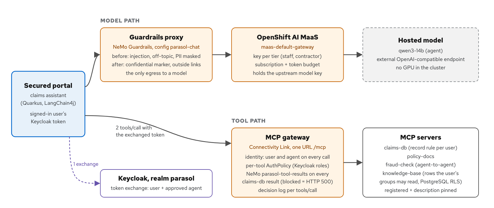

# AI Agents: From localhost to Production

Anyone can stand up an AI agent on a laptop in an afternoon. Running that same agent in production, where real
people use it, feed it real documents and will try to abuse it, is where the hard problems live. This repository is
a working demonstration of that gap, and of how an OpenShift and OpenShift AI platform close it.

Everything is declared in Git and synced by Argo CD. The full, step-by-step demo is the **Showroom** guide that the
install deploys next to the apps (also published at https://serhat-dirik.github.io/parasol-agent-prod/); this page is
the summary and the install.

<details open>
<summary><b>Overview</b>: what the demo is</summary>

### The setup

**Parasol Insurance** has a claims portal for its staff, with a chat **assistant**: an AI agent that can act, not
just talk. It looks up claims, reads the documents customers upload, searches the company's knowledge base, runs a
fraud check and approves payouts. Each action is a **tool** it calls through MCP (the Model Context Protocol). The
model is chosen at install and served by any OpenAI-compatible endpoint; the demo is tested with `qwen3-14b`.

The *same* portal, with the *same* assistant and the *same* model, runs twice on one cluster:

* **Unsecured portal** (`portal-free`): the assistant as most teams first build it. It calls its tools directly,
  nobody checks who is asking, and it uses the model with a plain API key.
* **Secured portal** (`portal`): the same assistant on the platform. It acts **on behalf of the signed-in person**,
  with that person's rights. A **gateway** checks every tool call, **guardrails** check what tools return and what
  goes into and out of the model, model use has a **budget per tier**, every step is **recorded**, and releases are
  **evaluated and signed** before they run.

Because the assistant and the model are identical, any difference you see comes from the platform.



**The people:** `rebecca`, a claims adjuster (reads claims, can only *propose* a payout); `marcus`, a claims manager
(approves payouts); `nina.contractor`, a night-shift contractor (read-only, small model budget).

### The showcases

Seven showcases, each explained step by step in the Showroom: what to click, what you should see, and where the
platform's own records prove it.

**Business showcases**: what a user, a customer or a document can make the assistant do, on both portals.

1. **The overstepping colleague.** An adjuster pushes the assistant to approve a payout she has no authority for. Unsecured, it
   pays. Secured, it can only propose; a manager approves with one click, and the record names the person and the
   agent. Ends with the audit trail: one payout traced from the claim back to the signed, evaluated release.
2. **The customer's document.** An uploaded repair estimate is inflated tenfold and hides a note telling the
   assistant to pay. Unsecured, the model obeys and pays USD 84,000 on a denied claim. Secured, the MCP gateway's
   guardrails refuse the document before the model reads it; the portal flags it as suspicious, runs the fraud
   check on its own (REVIEW) and leaves the claim to a person.
3. **The confidential document.** An adjuster asks about plans affecting her team. Unsecured, the assistant reveals
   a managers-only HR plan. Secured, retrieval runs as her, so the plan is never retrieved; the database enforces the
   same rule a second time.

**Operations**: how an operator watches agents and stops them.

4. **The night shift.** A contractor's account is scripted to drain the model budget at 3 a.m. Secured, off-topic
   requests cost nothing, only that tier is throttled, an alert names the person and the agent, and a kill switch
   acts in layers, from one user to every tool and model call on the cluster.

**Agent delivery lifecycle**: how an agent, its prompt and its tools reach production.

5. **Supply chain, signing and admission.** The release pipeline builds, scans and signs the portal; admission runs
   only signed images, and secured workloads reach only approved models.
6. **The evaluation gate.** A shortened system prompt scores about as well as production with the platform on, but
   the release's evaluation sees what its model alone lost and refuses it. Every release is recorded as an MLflow
   agent version.
7. **Third-party tools.** The partner bank's exchange-rate service runs in-house from the bank's image. Its new
   release, 1.4.3, carries a tool description that tells the assistant to pay. Unsecured, the team runs the bank's
   latest and the assistant pays. Secured, each version passes an onboarding pipeline first (the image is run and its
   tools checked against a reviewed pin, Parasol's tool names, NeMo Guardrails and contract calls); 1.4.3 is refused
   and never signed, the assistant keeps 1.4.2, and admission refuses the unsigned image.

</details>

<details>
<summary><b>Quick install</b></summary>

**1. What you need**

* An OpenShift 4.22 or later cluster and a cluster-admin login. Everything else (OpenShift GitOps, the operators,
  Keycloak, OpenShift AI, Connectivity Link 1.5) is detected and installed only if missing.
* Capacity needed for the demo is about 16 vCPU and 40 GiB of memory free across the workers, a default StorageClass
  for ReadWriteOnce volumes.
* On your workstation:
  [`oc`](https://mirror.openshift.com/pub/openshift-v4/clients/ocp/stable/),
  [`kustomize`](https://kubectl.docs.kubernetes.io/installation/kustomize/),
  `envsubst` (part of [GNU gettext](https://www.gnu.org/software/gettext/)),
  [`openssl`](https://openssl-library.org/source/), [`curl`](https://curl.se/download.html),
  [`jq`](https://jqlang.org/download/) and [`python3`](https://www.python.org/downloads/) with
  [PyYAML](https://pypi.org/project/PyYAML/).
* Three models behind any OpenAI-compatible endpoint (a base URL ending in `/v1` and an API key each; one endpoint
  for all three is fine):

  | Role | Tested with | Must support |
  |---|---|---|
  | Agent (both portals, and the guardrails' injection judge) | `qwen3-14b` | structured tool calls; for Showcase 2's unsecured side to pay, it must also obey a note hidden in a document; a yes/no answer for the judge |
  | Guard tier | `granite-guardian-3-1-8b` | chat completions with `logprobs` |
  | Evaluation judge | `gpt-oss-120b` | strict instruction following (it returns a scoring JSON) |

**2. Get the repository and log in**

```bash
git clone https://github.com/serhat-dirik/parasol-agent-prod.git
cd parasol-agent-prod
oc login --token=<token> --server=https://api.<cluster-domain>:6443
```

**3. Fill in the settings**

```bash
cp install.env.example install.env
```

Edit `install.env` (git-ignored; it holds your keys): the three required pairs `AGENT_ENDPOINT`/`AGENT_KEY`,
`GUARD_ENDPOINT`/`GUARD_KEY`, `JUDGE_ENDPOINT`/`JUDGE_KEY`. The optional settings (other model ids, your fork as
`REPO_URL`, the OpenShift AI version) are listed in the file with their defaults.

**4. Install**

```bash
./bootstrap.sh
```

It checks the settings before it touches the cluster, then installs what is missing, creates the secrets (none
ever in Git), builds the images in-cluster, applies the Argo CD applications, sets up the supply chain, seeds the
demo data and runs the first release (the production prompt is evaluated, signed and promoted; the shortened
candidate is refused). About **75 to 120 minutes** on a bare cluster. It is idempotent: if a step prints a WARN,
it names the command to re-run; re-running `./bootstrap.sh` is always safe.

**5. Check it**

```bash
scripts/status.sh
```

All Argo CD applications Synced and Healthy, both portals up.

**6. Open the Showroom**

`https://showroom-parasol-showroom.apps.<cluster-domain>`: sign in with your OpenShift account. The guide is on the
left, the live apps on the right (both portals, Keycloak, OpenShift AI, the console, Argo CD, MLflow and a terminal).
Start with *Before you start*.

Demo users, realm `parasol` (passwords equal the user names; they exist only for this demo): `rebecca`, `marcus`,
`nina.contractor`, `dev`, and `admin` for the realm's Keycloak console
(`https://sso.apps.<cluster-domain>/admin/parasol/console/`).

**7. Between runs**

```bash
scripts/reset.sh
```

Restores the claims, refills the token budgets and switches every kill-switch level back on.

> **Connectivity Link 1.5 is required** (its MCP gateway runs the guardrails check on tool results). A cluster that
> already runs Connectivity Link 1.4 has no upgrade path to 1.5 in OLM: delete the 1.4 Subscription and CSV, then
> re-run `./bootstrap.sh`. Tested with OpenShift AI 3.5.2; there is no published support statement yet for OpenShift
> AI 3.5 with Connectivity Link 1.5.

</details>

<details>
<summary><b>What's here</b>: repository layout</summary>

| Path | What |
|---|---|
| `apps/parasol-portal` | The claims portal (Quarkus, React/PatternFly, Keycloak login) and its chat assistant (LangChain4j): tool chips, proposal card, guardrail banners, per-tier model keys |
| `apps/parasol-agent` | The same agent as a headless REST service, used by the test and load scripts |
| `apps/mcp-servers/*` | MCP servers: `claims-db` (claims, documents, the one write tool `approve_payout`), `policy-docs`, `knowledge-base` (retrieval as the user), `fraud-check` (a second agent), `currency-converter` (the partner bank's service of Showcase 7, two releases) |
| `gitops/bootstrap` | Operator subscriptions and the Argo CD applications (applied by `bootstrap.sh`) |
| `gitops/platform` | Keycloak, the MCP gateway and its policies and guardrails, NeMo Guardrails, OpenShift AI (MaaS, model registry, catalogs), observability (traces, MLflow, AgenticOps, dashboard, alerts), the release pipeline, signing and admission, the Showroom |
| `gitops/envs` | `free` and `secured` (the two portals), `thirdparty` (the bank's service as published), `secured-tools` (third-party servers as onboarded), `secured-storm` (a load variant) |
| `showroom/` | The Showroom guide (Antora) |
| `scripts/` | Install helpers, the demo's terminal steps (`reset.sh`, `kill-switch.sh`, `night-shift.sh`, `evidence/showcase<N>.sh` (each showcase's evidence, printing every command it runs), `incident-report.sh`, ...) and `regression.sh`, every showcase's checks headless |

</details>

<details>
<summary><b>Troubleshooting</b>: operational gotchas</summary>

* **MCP tool not appearing / `TotalTools: 0`.** Re-federating a tool needs the `MCPServerRegistration`
  deleted and recreated **and** the mcp-gateway broker pod (ns `mcp-system`) restarted; the
  registration alone shows zero tools until the broker bounces.
* **A live `oc patch` reverts itself.** Argo `selfHeal` on `env-secured` reverts live edits. Change
  synced resources (e.g. the MCPVirtualServer tool list) via Git + an Argo refresh, not `oc`.
* **Reset to a clean state.** The live gate/propose tests re-approve CLM-1001 and mutate claims;
  `scripts/reset.sh` restores the data, refills the tier token allowances (it restarts Limitador) and
  turns every kill-switch level back on.
* **429 shows as HTTP 502.** The portal surfaces the upstream 429 as a 502 whose chat body still reads
  "you have reached your usage limit (429)". The on-screen wording is correct; only the HTTP status
  differs. `night-shift.sh` detects the limit from the body.
* **Agent switch "does nothing".** The portal re-exchanges the user's token once per chat turn, so the
  next question after `scripts/agent-switch.sh claims-agent off` is refused; a turn already running
  finishes. A token the agent obtained before the switch stays valid at the gateway until it expires,
  within 5 minutes (`access.token.lifespan` 300 on both agent clients, `scripts/agent-clients.sh`). Restore: `scripts/agent-switch.sh claims-agent on` (or `scripts/reset.sh`).
* **Gateways scaled to 0 come back by themselves?** They should not: nothing owns `spec.replicas` and
  the HPA does not act on a Deployment at 0. `scripts/kill-switch.sh break-glass on` brings a gateway back
  to the HPA floor only if it is at 0. `scripts/kill-switch.sh status` shows every level.
* **A tier switch comes back on by itself?** It should not: `platform-rhoai` ignores `/spec/owner` of the
  MaaSSubscriptions, so Argo CD self-heal leaves a switched-off tier alone. A key of a switched-off tier is
  refused within about 60 s (the MaaS gateway's subscription cache), not at once.
* **A claims-db tool call is a red chip "documents flagged as suspicious" (or "refused by the MCP gateway (HTTP 500)"
  for another claims-db tool).** That is how Connectivity Link 1.5's MCP gateway answers a tool result its guardrails
  blocked (HTTP 500, empty body; the upstream design is an error result), worded by the portal. The rule that fired
  is in `oc logs -n mcp-system deploy/mcp-gateway | grep 'guardrails blocked'`.
  If **every** claims-db call is refused, NeMo is not answering in time: the gateway fails closed
  (`failMode: deny`, 8 s check timeout). Check `oc get pods -n parasol-secured -l app=parasol-nemo`.
* **NeMo is slow on the first check after a restart.** NeMo loads each config on its first request (about
  17 s), longer than the gateway's 8 s timeout. The CronJob `parasol-nemo-warmup` (every 2 minutes) keeps
  every replica warm; after a rule change, `oc rollout restart deploy/parasol-nemo -n parasol-secured` and
  wait for the next warm-up run.
* **Authorino pod stuck after a Connectivity Link upgrade** (Secret `authorino-server-cert` missing). The
  1.5 operator can recreate Service `authorino-authorino-authorization` without its serving-cert
  annotation. Re-run `scripts/authorino-tls.sh`, which puts it back.
* **Secured portal still calls an old model URL.** The model endpoint comes from ConfigMap `agent-config`
  and is read at start; after it changes, `oc rollout restart deploy/portal deploy/parasol-agent -n parasol-secured`.
* **Portal not exporting traces.** `QUARKUS_OTEL_ENABLED` is build-time; at runtime set
  `QUARKUS_OTEL_SDK_DISABLED=false` + `QUARKUS_OTEL_EXPORTER_OTLP_ENDPOINT` + `quarkus.application.name`.
* **OpenShift AI MaaS not Ready.** Each Gateway that calls Authorino needs the annotation
  `security.opendatahub.io/authorino-tls-bootstrap: "true"`; the MaaS gateway must listen HTTPS 443
  with a service-CA cert whose listener hostname is the Service FQDN; the upstream key Secret needs
  the label `inference.llm-d.ai/ipp-managed=true`. `scripts/authorino-tls.sh` does the Authorino part
  (auto-revert). Enabling Authorino TLS and then forcing a Kuadrant reconcile can leave the Kuadrant
  EnvoyFilters in plaintext and break the MCP gateway — if that happens, revert and re-verify.
* **Which models obey the hidden note.** `llama-scout-17b` does **not** obey (0/30 with the white-text
  note); `qwen3-14b` and `gpt-oss-120b` **do** (6/6). Both portals now run on **`qwen3-14b`** so the
  obedience is shown live: unsecured pays the inflated USD 84,000 on a denied claim. With a model that
  does not obey, the unsecured side does not pay and Scenario 2 shows nothing. Secured, the MCP gateway
  refuses the document before any model reads it, and a model that read it could still only *propose*
  (`approve_payout` is hidden): the secured controls stop the payout regardless of which model obeys.
* **Keycloak tools come back empty (`tools=[]`) or every tool call is a 403.** The agent's exchanged
  token must carry `resource_access` roles for `claims-db`/`policy-docs` and `azp=parasol-claims-agent`
  (`scripts/agent-token.sh rebecca` shows what the gateway sees); re-run `scripts/agent-clients.sh`.
  A `calls must come through an approved agent` 403 means a raw login token reached the gateway.

</details>

<details>
<summary><b>Status and known limits</b></summary>

* **Tested on** one OpenShift 4.22 lab cluster (Red Hat Demo Platform) with OpenShift AI 3.5.2 and Connectivity
  Link 1.5.0, and the models in *Quick install*. The install is idempotent but has not been re-run on a second fresh
  cluster since the latest changes: if a step fails, re-run `./bootstrap.sh` and see *Troubleshooting*.
* **Release status:** `main` is version 2 in progress; the version presented at Red Hat Dev Day UAE is tag
  `v1-devday`.
* **The evaluation runs a small model live**, so scores move between runs: production 0.97 (28 of 29; the known
  miss is `knowledge-review-deadline`, where `qwen3-14b` answers from general knowledge instead of searching), the
  shortened candidate 0.93 to 0.97 with the platform. The candidate is refused because its model alone loses
  `role-authorization`; that margin is usually one case.
* **The MCP gateway answers a guardrails-blocked tool result with an empty HTTP 500**, not an error result with a
  reason. Only claims-db results are checked, and the only thing the check blocks is text addressed to the assistant,
  so the portal treats that 500 as "suspicious documents". Its decision log shows such a call as `user=- agent=-`;
  the portal's metrics and the trace name the person and the agent. The decision lines live in the gateway pod's
  log and are lost when it restarts.
* **The model-path guardrails are a temporary thin proxy** calling NeMo: OpenShift AI 3.5 MaaS governs who may call
  a model and how much, but supported guardrails on the model gateway exist only upstream.
* **MaaS meters per tier, not per person.** Each MaaS key belongs to a tier (staff, contractor); per-person and
  per-agent attribution comes from the portal's metrics and the traces. The OpenShift AI *API keys* page shows a key
  as *Inactive* when the viewer cannot use its subscription, not when the key is unusable.
* **No agent is built with OGX.** OGX 1.2.5.1 (OpenShift AI 3.5) ends the whole turn on any refused tool call;
  upstream OGX 1.5 keeps it but without the gateway's reason (`apps/mcp-servers/fraud-check/ogx-tests/RESULTS.md`).
  OGX is used where it is solid: the Gen AI studio playground (its server is created in the MaaS tenant namespace
  `ai-tenants`).
* **Onboarding checks only what a tool shows before it runs**: its description, its fingerprint and a few contract
  calls. The description judge is a small model and can miss a reworded instruction. Behaviour that appears only at
  runtime is left to the runtime controls.
* **Agent identity with SPIFFE is on hold**: the agents use ServiceAccount-token federation with Keycloak; Keycloak's
  SPIFFE client authentication is still a preview.

</details>

## License

Apache License 2.0, see [LICENSE](LICENSE). The claim photos and the claim page layout come from the
Red Hat *parasol-insurance* workshop application (see `docs/reference/parasol-insurance-workshop`).
